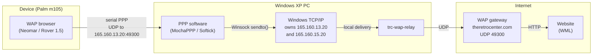
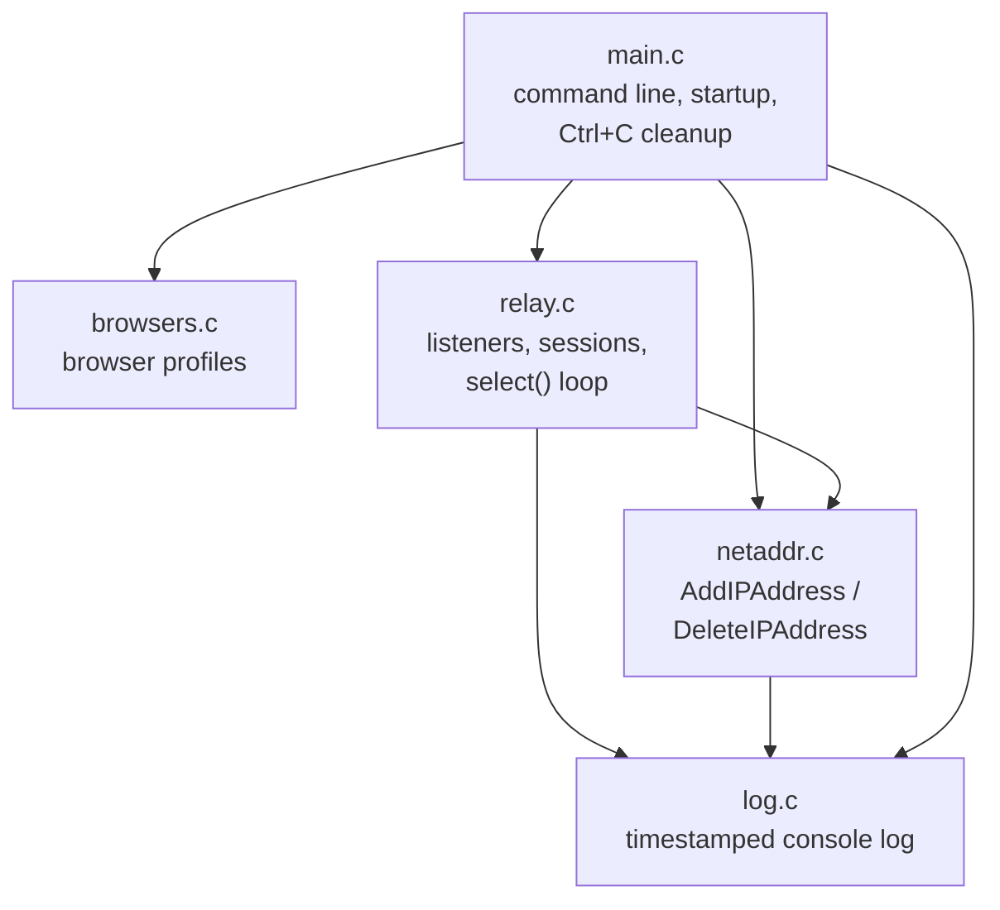
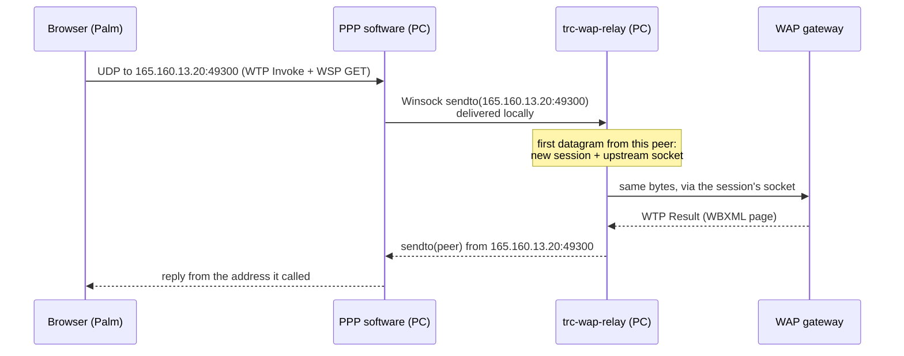

# Architecture

*[Leer en español](../es/ARQUITECTURA.md)*

## The problem

A vintage WAP browser never asks DNS where its gateway is. The operator's
gateway IP address and port are hardwired into the browser (or the device's
settings can't be changed anymore), and that gateway shut down long ago.
Every request the browser makes is a UDP datagram sent to a dead address.

To bring the browser back, *something* must receive datagrams addressed to
that dead IP and answer **from that same IP**: WAP clients match replies by
source address and silently drop anything else.

When the device reaches the internet through a Windows PC (a Palm on a
serial cradle with MochaPPP or Softick PPP, for example), that something can
be the PC itself.

## Network topology

PlantUML source: [network-topology.puml](../diagrams/network-topology.puml).

## Why the PC owns the dead address

The obvious tool - rewriting the destination of the packets (DNAT) - doesn't
exist on Windows XP. Two other approaches were tried before this design:

| Approach | Why not |
|---|---|
| Static route + static ARP entry pointing the dead IP at another machine (neomar-wap-proxy's original setup) | ARP only reaches the local Ethernet segment, so the gateway has to be **on your LAN**, and a second machine is needed. |
| A relay machine on the LAN holding the dead IPs | Works, but it's still a second machine. |
| **The PC owns the dead IPs and relays itself** (this project) | PPP software such as MochaPPP is a user-mode program: it forwards the device's packets with ordinary Winsock calls. If the destination address belongs to the PC, Windows delivers the packet locally - to the relay - with no routing involved. |

The relay adds the addresses at startup with the IP Helper API
(`AddIPAddress`) on the connection Windows uses to reach the gateway, and
removes them on exit (`DeleteIPAddress`). They are never persistent: a
reboot or a reset of that connection drops them too.

Windows XP rejects a /32 netmask for these addresses (the address would be
its own network and broadcast address), so the relay falls back to /29 -
the dead operator range loses 8 addresses of reachability from this PC,
which nobody uses anyway. Newer Windows versions take the /32.

## Components

| Module | Responsibility |
|---|---|
| `browsers.c` | One `BrowserProfile` per supported browser: the dead gateway addresses it calls, the UDP port, and the port of the same service on the remote gateway. Pure data. |
| `relay.c` | Browser-agnostic UDP relay. A *listener* is one (address, port) the PC answers on, bound to a profile. A *session* is one device-side peer (ip:port) on one listener, with its own upstream socket connected to the gateway. |
| `netaddr.c` | Claims a missing address on the right connection (`GetBestInterface` + `AddIPAddress`, trying /32, /29, /24) and releases everything it added. |
| `main.c` | Parses options, resolves the gateway once, opens one listener per profile address, installs the console handler that releases the addresses on Ctrl+C or window close. |
| `log.c` | Console output; traffic lines can be silenced with `-q`. |

PlantUML source: [components.puml](../diagrams/components.puml).

## Request flow

PlantUML source: [relay-sequence.puml](../diagrams/relay-sequence.puml).

The relay never parses the payload: it forwards bytes. That keeps it
protocol-independent - the browser-specific part lives in the remote
gateway - and means one engine serves every UDP-based browser profile.

## Design decisions

- **One upstream socket per device peer.** The gateway sees each session as
  a distinct client, so its replies map back to the right peer without the
  relay keeping any per-transaction state. Idle sessions expire after 2
  minutes; when the table is full the least recently used one is recycled.
- **Replies leave from the listener's socket**, i.e. from the address the
  device called. A reply from any other address is dropped by WAP clients.
- **`select()` on one thread.** Listeners plus sessions are capped below
  Winsock's `FD_SETSIZE` (64), which is plenty for a handful of devices.
- **XP-only APIs.** No `inet_pton`, `GetTickCount64` or other Vista+ calls;
  the PE header is pinned to 5.01; static linking avoids MinGW runtime DLLs.
- **The gateway is resolved once at startup** with `gethostbyname`. Restart
  the relay if the gateway's address changes.
- **Not persistent by design.** Nothing is written to the registry or the
  network configuration; closing the relay leaves the PC as it was.

## Limits

- UDP only. A browser that reaches its gateway over TCP (e.g. a WAP 2.0
  HTTP proxy) would need a TCP relay alongside `relay.c` - see
  [Adding a browser](ADDING_A_BROWSER.md).
- IPv4 only, like every browser of the era.
- Adding addresses needs administrator rights; `-n` skips that step for
  addresses configured by hand.
