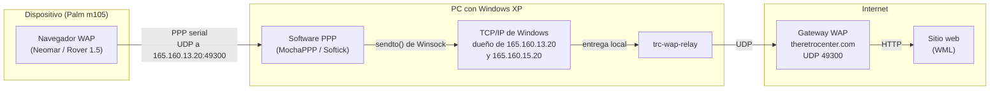
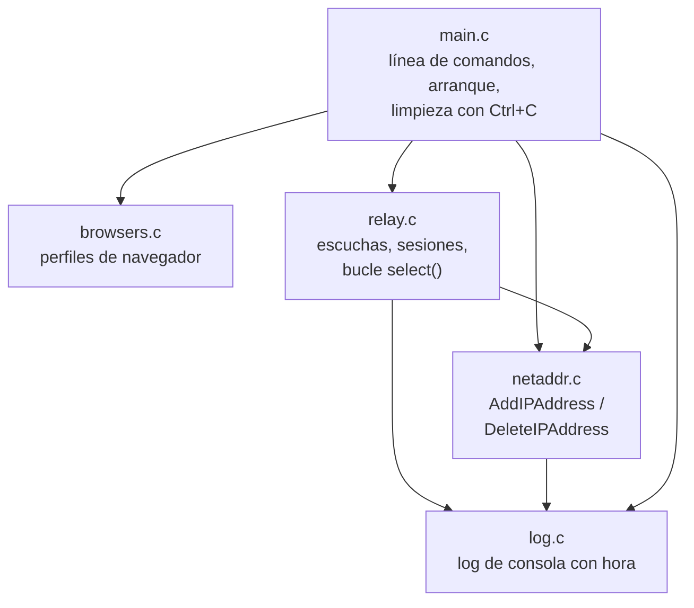
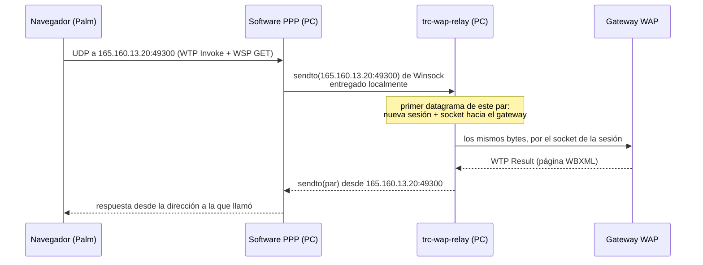

# Arquitectura

*[Read in English](../en/ARCHITECTURE.md)*

## El problema

Un navegador WAP antiguo nunca le pregunta al DNS dónde está su gateway. La
IP y el puerto del gateway del operador vienen grabados en el navegador (o
la configuración del dispositivo ya no se puede cambiar), y ese gateway se
apagó hace mucho. Cada petición del navegador es un datagrama UDP enviado a
una dirección muerta.

Para revivir el navegador, *algo* tiene que recibir los datagramas
dirigidos a esa IP muerta y responder **desde esa misma IP**: los clientes
WAP asocian las respuestas por dirección de origen y descartan en silencio
cualquier otra.

Cuando el dispositivo llega a internet a través de un PC con Windows (una
Palm en su cuna serial con MochaPPP o Softick PPP, por ejemplo), ese algo
puede ser el propio PC.

## Topología de red

Fuente PlantUML: [network-topology.puml](../diagrams/network-topology.puml).

## Por qué el PC se adueña de la dirección muerta

La herramienta obvia - reescribir el destino de los paquetes (DNAT) - no
existe en Windows XP. Antes de este diseño se probaron otros dos enfoques:

| Enfoque | Por qué no |
|---|---|
| Ruta estática + entrada ARP estática apuntando la IP muerta a otra máquina (la configuración original de neomar-wap-proxy) | ARP solo llega al segmento Ethernet local, así que el gateway tiene que estar **en tu LAN**, y hace falta una segunda máquina. |
| Una máquina de reenvío en la LAN que tenga las IPs muertas | Funciona, pero sigue siendo una segunda máquina. |
| **El PC se adueña de las IPs muertas y reenvía él mismo** (este proyecto) | El software PPP como MochaPPP es un programa de modo usuario: reenvía los paquetes del dispositivo con llamadas Winsock normales. Si la dirección de destino pertenece al PC, Windows entrega el paquete localmente - al relay - sin ningún enrutamiento de por medio. |

El relay agrega las direcciones al arrancar con la API IP Helper
(`AddIPAddress`) sobre la conexión que Windows usa para llegar al gateway, y
las quita al salir (`DeleteIPAddress`). Nunca son persistentes: un reinicio
o un reinicio de esa conexión también las elimina.

Windows XP rechaza una máscara /32 para estas direcciones (la dirección
sería su propia dirección de red y de broadcast), así que el relay cae a
/29 - el rango muerto del operador pierde 8 direcciones de alcance desde
este PC, que nadie usa de todos modos. Las versiones más nuevas de Windows
aceptan /32.

## Componentes

| Módulo | Responsabilidad |
|---|---|
| `browsers.c` | Un `BrowserProfile` por navegador soportado: las direcciones muertas del gateway a las que llama, el puerto UDP, y el puerto del mismo servicio en el gateway remoto. Solo datos. |
| `relay.c` | Reenvío UDP independiente del navegador. Una *escucha* es una (dirección, puerto) en la que responde el PC, asociada a un perfil. Una *sesión* es un par del lado del dispositivo (ip:puerto) en una escucha, con su propio socket conectado al gateway. |
| `netaddr.c` | Agrega una dirección faltante en la conexión correcta (`GetBestInterface` + `AddIPAddress`, probando /32, /29, /24) y libera todo lo que agregó. |
| `main.c` | Interpreta las opciones, resuelve el gateway una vez, abre una escucha por cada dirección del perfil e instala el manejador de consola que libera las direcciones con Ctrl+C o al cerrar la ventana. |
| `log.c` | Salida por consola; las líneas de tráfico se pueden silenciar con `-q`. |

Fuente PlantUML: [components.puml](../diagrams/components.puml).

## Flujo de una petición

Fuente PlantUML: [relay-sequence.puml](../diagrams/relay-sequence.puml).

El relay nunca interpreta el contenido: reenvía bytes. Eso lo mantiene
independiente del protocolo - la parte específica de cada navegador vive en
el gateway remoto - y permite que un solo motor sirva a todos los perfiles
de navegadores basados en UDP.

## Decisiones de diseño

- **Un socket hacia el gateway por cada par del dispositivo.** El gateway
  ve cada sesión como un cliente distinto, así que sus respuestas vuelven al
  par correcto sin que el relay guarde estado por transacción. Las sesiones
  inactivas expiran a los 2 minutos; si la tabla se llena, se recicla la
  usada hace más tiempo.
- **Las respuestas salen por el socket de la escucha**, es decir, desde la
  dirección a la que llamó el dispositivo. Los clientes WAP descartan una
  respuesta desde cualquier otra dirección.
- **`select()` en un solo hilo.** Escuchas más sesiones quedan por debajo
  del `FD_SETSIZE` (64) de Winsock, de sobra para unos pocos dispositivos.
- **Solo APIs de XP.** Nada de `inet_pton`, `GetTickCount64` ni otras
  llamadas de Vista en adelante; la cabecera PE fija la versión 5.01; el
  enlace estático evita depender de DLLs del runtime de MinGW.
- **El gateway se resuelve una vez al arrancar** con `gethostbyname`.
  Reinicia el relay si cambia la dirección del gateway.
- **No persistente por diseño.** No se escribe nada en el registro ni en la
  configuración de red; al cerrar el relay, el PC queda como estaba.

## Límites

- Solo UDP. Un navegador que llegue a su gateway por TCP (por ejemplo, un
  proxy HTTP de WAP 2.0) necesitaría un reenvío TCP junto a `relay.c` - ver
  [Agregar un navegador](AGREGAR_UN_NAVEGADOR.md).
- Solo IPv4, como todos los navegadores de la época.
- Agregar direcciones requiere permisos de administrador; `-n` omite ese
  paso para direcciones configuradas a mano.
